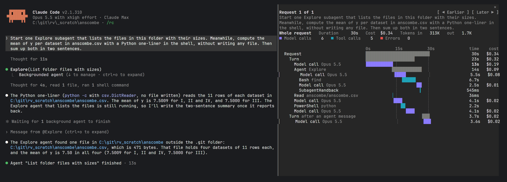

<h1 align="center">Claude Code Trace Waterfall</h1>

<p align="center">
  A live waterfall of each Claude Code request: every model call, tool call and subagent on one time axis, with duration and estimated cost
</p>

<p align="center">
  
  
  
  
</p>

<p align="center">
  
</p>

> [!NOTE]
> trace-waterfall is a Claude Code **mod** and needs **Claude Code 2.1.306+**. The Trace pane docks beside the chat in the fullscreen layout (`/tui fullscreen`) from 110 columns, and opens above the prompt otherwise. It opens by itself when a session starts in a terminal at least 144 columns wide; `/trace-waterfall` opens it at any width. Tested in the terminal on Windows and Linux.

---

## Installation

At the prompt of a Claude Code session in a terminal:

```text
/plugin install trace-waterfall --marketplace vdvoorder/claude-code-trace-waterfall
```

Answer `y` to add the marketplace, then pick a scope: user installs the mod for every project.

From a shell:

```bash
claude plugin install trace-waterfall --marketplace vdvoorder/claude-code-trace-waterfall
```

In the desktop app, where `/plugin` does not run: click + next to the prompt box, then Plugins, Add marketplace with `vdvoorder/claude-code-trace-waterfall`, then Add plugin.

To update, run `claude plugin update trace-waterfall@claude-code-trace-waterfall`, then `/reload-plugins` in a running session.

## Features

- One row per span: the request, each model call, each tool call and each subagent, nested under what started it and drawn as a bar on one time axis
- A request with more than one turn, such as a turn after a background task or a subagent's message, also gets a row for each turn
- Live: a running call grows every second, and a line marks the present moment
- Subagents nest under the Agent call that started them, with their own model and tool calls, also when a subagent starts another
- The header sums the request: duration, estimated cost, tokens in and out, model calls, tool calls and errors
- Click a row to sum only that span and what it started; click it again for the whole request
- The slowest call's duration is in bold, and failed calls are red
- ◀ Earlier and Later ▶ page through the last 20 requests; a turn that answers a subagent's message joins the request that started the subagent
- Ask Claude to show the trace, and it reopens the pane with the mod's own `open_pane` tool

## Settings

Change the setting with `/plugin configure trace-waterfall@claude-code-trace-waterfall`.

```yaml
Open at start:  on | off
```

## Cost

The cost is an estimate at Anthropic's API list prices per million tokens, from the tokens each model call reports:

- Cache writes count at the 5-minute cache rate. A request that writes to the 1-hour cache costs more than the estimate.
- Claude Haiku 5.5 counts at its higher prices when a model call's prompt is over 100,000 tokens.
- A model the price table does not know shows no cost.
- On a Claude subscription the estimate says what the same tokens would cost on the API, not what the subscription charges.

## Considerations

- `/clear` empties the pane
- The pane keeps the last 20 requests of the session
- The Desktop app and macOS are covered by the tests and CI, but not yet tried by hand

## Contributing

Turn on the pre-commit hook once per clone; it runs `claude plugin validate` and the tests before each commit that touches the mod:

```bash
git config core.hooksPath .githooks
```

The same checks run on Linux, macOS and Windows in CI on every push that touches the mod. Agent rules for this repository are in [AGENTS.md](AGENTS.md).

## License

[MIT](LICENSE). The layout follows a trace waterfall component that [flohoeller](https://x.com/flohoeller) posted on X.
